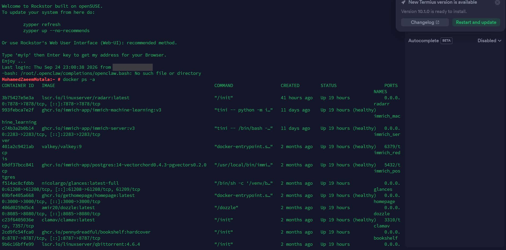

# Services

All containers run on this host and are only reachable over Tailscale — nothing is exposed to the public internet.

## Managed via docker-compose

**immich** — photo backup and management
- immich_server, immich_machine_learning, immich_redis, immich_postgres

**nas-dashboard**
- homepage — dashboard
- dozzle — live container log viewer

**books-stack**
- bookshelf — book library
- kavita — comic/ebook reader

## Standalone (docker run)

| Service | Image | Purpose |
|---|---|---|
| jellyfin | jellyfin/jellyfin:10.11.8 | Media server |
| radarr | linuxserver/radarr | Movie management |
| sonarr | linuxserver/sonarr | TV management |
| prowlarr | linuxserver/prowlarr | Indexer management |
| qbittorrent | linuxserver/qbittorrent:4.6.4 | Torrent client |
| flaresolverr | flaresolverr/flaresolverr | Cloudflare bypass for indexers |
| frigate | blakeblackshear/frigate | NVR / CCTV with object detection |
| ollama | ollama/ollama | Local LLM runner |
| nextcloud | nextcloud | File sync/storage |
| clamav | clamav/clamav | Antivirus scanning |
| pihole | pihole/pihole | Network-wide DNS/ad-blocking |
| glances | nicolargo/glances | System resource monitor |
| ntfy | binwiederhier/ntfy | Push notifications |

*Planned: migrate the standalone containers to compose files for reproducibility.*

## Set up but currently stopped

| Service | Image | Purpose |
|---|---|---|
| gotify | gotify/server | Push notifications (secondary to ntfy) |
| cloudflared | cloudflare/cloudflared | Cloudflare tunnel client |

*Running count verified with `docker ps` on 2026-10-11: 21 containers (8 compose-managed, 13 `docker run`).*
